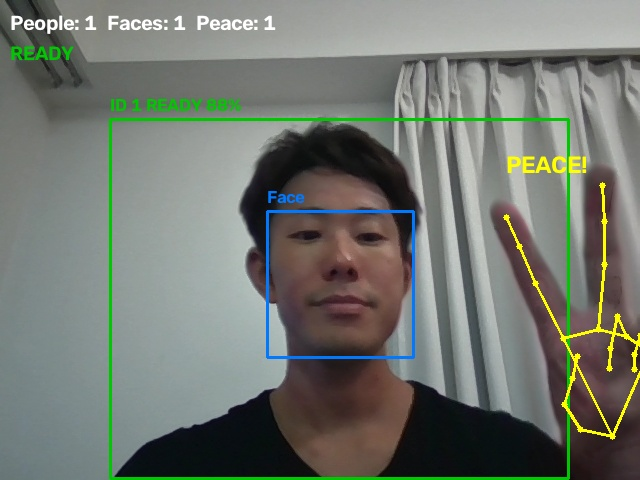

# photographer

カメラ画像からピースサインを検出したら、写真を取り、instax miniから写真を印刷するソフトウェア。  

## 実行方法

1. instax miniの電源を入れる
2. ソフトウェアを起動
```bash
bash run_photographer.sh
```

## Result


## 終了方法
キーボードの'q'でstop, terminalでCtrl+c

## detail
- [setting](setting.md)
- [トラブルシューティング](https://github.com/kokkia/photographer/issues/2)
